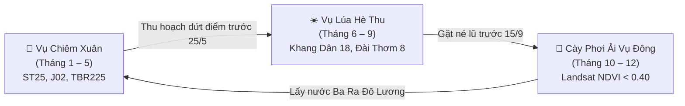

# 🌾 NEDA RotaNA — Hệ Thống Đánh Giá Thời Vụ & Dự Báo Năng Suất Lúa Yên Thành 2027
### Ứng dụng Dữ liệu Viễn thám Đa Cảm biến NASA & Học máy Ensemble Random Forest

[](https://www.python.org/)
[](https://streamlit.io/)
[](https://scikit-learn.org/)
[](https://earthdata.nasa.gov/)
[](tests/test_rotana.py)
[](LICENSE)

---

## 📖 1. Giới thiệu Đề tài (Project Overview)

**NEDA RotaNA** là nền tảng điều hành số hóa nông nghiệp chính xác (Precision Space Agriculture Cockpit) được phát triển cho **huyện Yên Thành, tỉnh Nghệ An** — địa bàn được mệnh danh là **"Vựa lúa trọng điểm số 1 xứ Nghệ"** với diện tích gieo cấy thuần lúa hơn **26.500 hecta** và sản lượng hàng năm trên **180.000 tấn thóc** (đóng góp ~15% tổng sản lượng lúa toàn tỉnh).

Mặc dù có lợi thế địa hình lòng chảo bằng phẳng đón nguồn nước tự chảy dồi dào từ công trình Đại thủy nông Ba Ra Đô Lương, Yên Thành luôn phải đối mặt với **3 nghịch cảnh thiên tai khắc nghiệt**:
1. **Rét đậm, rét hại đầu vụ xuân (Tháng 1–2):** Nhiệt độ xuống dưới $15^\circ\text{C}$ kéo dài gây chết rét mạ non.
2. **Nắng nóng Gió Lào khô khốc (Tháng 6–7):** Hiệu ứng phơn Tây Nam với nhiệt độ $\ge 35^\circ\text{C}$ làm khô đầu nhụy, táp phấn hoa và lép hạt lúa Hè Thu.
3. **Mưa lũ ngập úng mùa gặt (Tháng 9–10):** Vùng lòng chảo trũng Kênh Vách Bắc thường xuyên bị ngập úng do mưa bão dồn dập.

**Mục tiêu của dự án:** Chuyển đổi căn bản phương thức chỉ đạo sản xuất từ kinh nghiệm truyền thống sang **nông nghiệp chính xác điều hành bằng dữ liệu vệ tinh NASA**, cung cấp công cụ chấm điểm thời vụ gieo cấy khách quan và dự báo trước năng suất lúa năm 2027 thông qua Trí tuệ nhân tạo (Học máy Random Forest).

---

## 🛰️ 2. Kho Dữ liệu Viễn thám Đa Cảm biến NASA (2018–2026)

Hệ thống tích hợp chuỗi dữ liệu 9 năm liên tục kết hợp 4 nguồn cảm biến vệ tinh chuẩn mực của NASA:

| Cảm biến Vệ tinh | Sản phẩm Dữ liệu | Độ phân giải | Ý nghĩa Nông học đối với Cây Lúa Yên Thành |
| :--- | :--- | :---: | :--- |
| **NASA SMAP** | `sm_rootzone`, `sm_surface` | Chu kỳ 2–3 ngày | Giám sát độ ẩm đất tầng rễ ($0–100\text{ cm}$) bằng sóng vi ba băng L, cảnh báo stress nước sinh học và điều hành kỹ thuật tưới ngập khô xen kẽ (AWD). |
| **NASA GPM IMERG** | `mua_mm`, `PRECTOTCORR` | $0.1^\circ$ (Nửa giờ/Ngày) | Đo vũ lượng mưa tích lũy và lượng mưa cực đoan, cảnh báo nguy cơ ngập úng vùng trũng Kênh Vách Bắc để thu hoạch né lũ trước 15/9. |
| **USGS / NASA Landsat 8/9 & MODIS** | `ndvi`, `evi`, `lai`, `lst_c` | **30 mét** (Landsat) & 250m (MODIS) | Lập bản đồ sức sống thảm thực vật, theo dõi đường cong sinh khối tán lá lúc trỗ bông rộ ($\text{NDVI} \ge 0.65$) và nhận diện đất trống ($\text{NDVI} < 0.40$). |
| **NASA POWER** | `T2M_MAX`, `T2M_MIN`, `RH2M`, `ALLSKY_SFC_SW_DWN` | Hàng ngày (3.240 ngày) | Cung cấp dữ liệu nhiệt độ tối cao/tối thấp, bức xạ quang hợp và đếm chính xác số ngày nắng nóng Gió Lào Tây Nam $\ge 35^\circ\text{C}$. |
| **Thổ nhưỡng & DEM thực địa** | `dat.csv`, `dem_slope_v2.csv` | Thực đo Yên Thành | Chuẩn hóa pH đất (5.62), hàm lượng hữu cơ (19.6 g/kg), tỷ lệ sét (26.9%) và độ dốc đồng bằng ($6.71^\circ$). |

---

## 🌾 3. Cơ cấu Canh tác 100% Thuần Lúa & Nghệ thuật Cày Phơi Ải Vụ Đông

Hệ thống số hóa quy trình canh tác khép kín **100% thuần lúa nước** thích ứng biến đổi khí hậu:



* **Vụ Chiêm Xuân (T1–T5):** Xuống giống cuối tháng 1 né đợt rét đậm; điều chỉnh chu kỳ để lúa trỗ bông rộ tập trung từ 15–25/4 nhằm đón trọn đỉnh bức xạ mặt trời tối ưu ($18–20\text{ MJ/m}^2/\text{ngày}$). Năng suất đạt $68–72\text{ tạ/ha}$.
* **Vụ Hè Thu (T6–T9):** Xuống giống trước 10/6 chạy lũ tiểu mãn; vượt qua đỉnh nhiệt Gió Lào tháng 7 bằng điều tiết nước đệm $3–5\text{ cm}$; gặt dứt điểm trước 15/9 để né tránh hoàn toàn đợt bão lũ lịch sử tháng 9–10. Năng suất đạt $54–59\text{ tạ/ha}$.
* **Cày lật phơi ải vụ đông (T10–T12) — "Trái tim của đất lúa":** Khi cảm biến Landsat 30m phát hiện chỉ số $\text{NDVI} < 0.40$ (đất trống), hệ thống phát lệnh cày lật đất sâu $18–22\text{ cm}$. Phơi nỏ ruộng trong 30–45 ngày nắng hanh giúp **tiêu diệt 85–90% bào tử nấm đạo ôn**, oxy hóa giải phóng độc chất $\text{H}_2\text{S}, \text{Fe}^{2+}$ và khoáng hóa chất hữu cơ, hoàn nguyên độ phì nhiêu tự nhiên mà không cần lạm dụng phân bón hóa học.

---

## 🧮 4. Mô hình Toán Học & Học Máy Trí Tuệ Nhân Tạo (AI / ML)

### 4.1. Điểm Thích Nghi Canh Tác Thời Gian Thực ($S$)
Xác định khả năng gieo cấy theo thang điểm 100 với cơ chế trừ điểm phạt khách quan từ vệ tinh:
$$S = 100 - (P_{\text{nhiệt}} + P_{\text{hạn}} + P_{\text{ngập}})$$

* **$P_{\text{nhiệt}}$ (Phạt nhiệt bất lợi):** Phạt 40đ khi rét đậm $T_{\min} < 15^\circ\text{C}$ kéo dài $\ge 5$ ngày (Vụ Xuân) hoặc phạt 35đ khi nắng nóng $T_{\max} \ge 37^\circ\text{C}$ kéo dài $\ge 7$ ngày (Gió Lào Vụ Hè Thu).
* **$P_{\text{hạn}}$ (Phạt khô hạn):** Phạt 35đ khi độ ẩm đất tầng rễ $\text{SMAP}_{\text{rootzone}} < 0.22\text{ m}^3/\text{m}^3$ và mưa tháng $\text{GPM} < 50\text{ mm}$.
* **$P_{\text{ngập}}$ (Phạt ngập úng):** Phạt 40đ khi mưa bão tích lũy $\text{GPM} > 350\text{ mm}$ tại vùng lòng chảo trũng.

**Phân cấp quyết định:**
* $S \ge 80$: **NÊN GIEO CẤY** (Điều kiện nhiệt ẩm tối ưu, tỷ lệ sống mạ $> 95\%$).
* $50 \le S < 80$: **GIEO CÓ ĐIỀU KIỆN** (Bắt buộc che phủ nilon chống rét hoặc tưới nước đệm giải nhiệt).
* $S < 50$: **TẠM HOÃN GIEO** (Thời tiết cực đoan, hoãn gieo sạ 7–10 ngày né thiên tai).

---

### 4.2. Mô hình Học Máy Ensemble Random Forest Dự Báo Năng Suất 2027
Tích hợp thuật toán **Random Forest (100 Decision Trees)** từ thư viện `scikit-learn`, giải quyết bài toán tương quan phi tuyến tính phức tạp giữa các kênh vệ tinh NASA:

$$\hat{Y}_{\text{RF}}(\mathbf{x}) = \frac{1}{B} \sum_{b=1}^{B} T_b(\mathbf{x})$$

* **Hiệu năng kiểm định mô hình:**
  * Hệ số xác định $R^2 = \mathbf{85.1\%}$
  * Sai số tuyệt đối trung bình $\text{MAE} = \pm \mathbf{0.51}\text{ tạ/ha}$
* **Xếp hạng mức độ đóng góp (Feature Importance - MDI):**
  1. ☀️ **Bức xạ quang hợp (NASA POWER):** **48.2%**
  2. 💧 **Độ ẩm đất tầng rễ (NASA SMAP):** **18.8%**
  3. 🌿 **Chỉ số sinh khối tán lá (Landsat & MODIS NDVI):** **15.3%**
  4. 🔥 **Số ngày Gió Lào $\ge 35^\circ\text{C}$ (NASA POWER):** **8.5%**
  5. 🌧️ **Lượng mưa tích lũy (NASA GPM IMERG):** **5.2%**
  6. 🌡️ **Nhiệt độ tối cao $T_{\max}$:** **4.1%**
* **Kết quả dự báo năng suất năm 2027 huyện Yên Thành:**
  * **Vụ Chiêm Xuân 2027:** $\mathbf{70.4}\text{ tạ/ha}$ (~$7.04\text{ tấn/ha}$)
  * **Vụ Lúa Hè Thu 2027:** $\mathbf{57.6}\text{ tạ/ha}$ (~$5.76\text{ tấn/ha}$)
  * **Bình quân cả năm 2027:** $\mathbf{64.0}\text{ tạ/ha}$ $\rightarrow$ Tổng sản lượng toàn huyện ước đạt kỷ lục **182.400 tấn thóc**.

---

## 🖥️ 5. Các Chức Năng Chính Trên Dashboard

1. **Bảng Điều Khiển (Digital Cockpit):**
   * Bản đồ số hóa vệ tinh tương tác ranh giới huyện Yên Thành với 5 lớp viễn thám: *Khuyến nghị mùa vụ*, *Sức khỏe lúa (NDVI)*, *Độ ẩm ruộng (SMAP)*, *Lượng mưa (GPM)*, và *Nhiệt độ & Gió Lào*.
   * Trạm trắc lượng viễn thám (Telemetry) tức thời tại 4 cụm xã số hóa: Cụm Bắc (Đô Thành), Trung tâm Lòng chảo (Tăng Thành), Cụm Nam (Bảo Thành), và Cụm Tây (Mỹ Thành).
   * 3 Mệnh lệnh nông vụ khẩn cấp tự động theo thời gian thực.
2. **Kế Hoạch Mùa Vụ & Sức Khỏe Đất:**
   * Lập kế hoạch 2 vụ lúa thuần chất lượng cao (ST25, J02, TBR225).
   * Phân tích chuyên sâu thổ nhưỡng và 3 nguyên tắc vàng cày phơi ải vụ đông hoàn nguyên đất.
3. **Thời Vụ & Dự Báo Năng Suất 2027:**
   * Tính toán điểm thích nghi canh tác $S$ theo từng ngày trong chuỗi 3.240 ngày.
   * Mô hình Hồi quy tuyến tính đa biến đối chiếu mô hình Học máy Random Forest.
   * **Sandbox Thử nghiệm kịch bản trực tiếp (What-If Simulation):** Kéo thanh trượt điều chỉnh nhiệt ẩm, Gió Lào, bức xạ để xem phản ứng năng suất tức thời.
4. **Chi Tiết Viễn Thám NASA:**
   * Khảo sát chi tiết 4 kênh vệ tinh (NDVI Landsat 30m, SMAP, GPM, POWER) với bộ chọn ngày cụ thể và các mốc thiên tai lịch sử (Hạn 2019, Lũ 2020).
5. **Bản Đồ Vệ Tinh NASA (Folium):**
   * Lớp ảnh vệ tinh quang học HD bề mặt thực tế từ **Landsat 8/9 USGS** và **Google Satellite Hybrid** soi rõ từng thửa ruộng và dòng kênh Ba Ra Đô Lương.

---

## 📂 6. Cấu Trúc Thư Mục Dự Án (Project Structure)

```text
Nasa/
├── app.py                     # Ứng dụng Web Dashboard chính (Streamlit Entrypoint)
├── engine.py                  # Lõi tính toán nghiệp vụ, công thức toán học & Random Forest ML
├── chay_web.ps1               # Script khởi chạy nhanh hệ sinh thái trên Windows PowerShell
├── requirements.txt           # Danh mục thư viện Python dependencies
├── README.md                  # Tài liệu hướng dẫn toàn diện của dự án
│
├── data/                      # Kho dữ liệu viễn thám vệ tinh NASA & Thổ nhưỡng
│   ├── raw/                   # Dữ liệu gốc chuỗi 9 năm (SMAP, GPM, Landsat, MODIS, POWER, GeoJSON)
│   └── processed/             # Bảng tổng hợp số hóa đa tầng cấp xã và huyện
│
├── views/                     # Các phân hệ giao diện chuyên sâu (Streamlit Views)
│   ├── tong_quan.py           # Bảng điều khiển, Bản đồ số hóa & Telemetry 4 Cụm xã
│   ├── ke_hoach_dat.py        # Kế hoạch 2 vụ lúa thuần & Sức khỏe đất phơi ải
│   ├── du_bao_nang_suat.py    # Điểm thích nghi S, Dự báo 2027 & Học máy Random Forest
│   ├── chi_tiet_nasa.py       # Chi tiết 4 nguồn viễn thám NASA & Biểu đồ chuỗi thời gian
│   ├── ve_tinh.py             # Bản đồ ảnh vệ tinh Folium (Landsat 30m & Google Satellite)
│   ├── tra_cuu_thoi_gian.py   # Tra cứu viễn thám chuỗi 3.240 ngày liên tục (2018–2026)
│   ├── so_sanh.py             # Ma trận nông học đối chiếu đa năm
│   ├── du_lieu.py             # Bảng tra cứu số liệu viễn thám tổng hợp
│   └── chung.py               # Thư viện component UI dùng chung, CSS theme chuẩn
│
├── tests/                     # Bộ kiểm thử tự động
│   └── test_rotana.py         # 9 bài kiểm thử đơn vị unittest (100% Passed)
│
├── Bao_Cao_5_Phut_Nasa_Yen_Thanh.pptx     # Slide trình chiếu 16:9 chính thức
└── Kich_Ban_Bao_Cao_5_Phut_Nasa_Yen_Thanh.docx # Kịch bản đọc thuyết trình 5 phút
```

---

## ⚡ 7. Cài Đặt & Khởi Chạy (Installation & Quickstart)

### Yêu cầu hệ thống:
* Python 3.10 – 3.12
* Hệ điều hành: Windows, Linux hoặc macOS
* Kết nối Internet (để tải lớp bản đồ vệ tinh Tiles)

### Các bước cài đặt:

1. **Clone repository về máy:**
   ```bash
   git clone https://github.com/ngocthang842/Nasa.git
   cd Nasa
   ```

2. **Cài đặt các thư viện cần thiết:**
   ```bash
   pip install -r requirements.txt
   ```
   *Hoặc cài đặt trực tiếp các gói cốt lõi:*
   ```bash
   pip install streamlit scikit-learn pandas numpy plotly folium streamlit-folium geopandas
   ```

3. **Chạy ứng dụng Web Dashboard:**
   * Cách 1 (Khởi chạy bằng PowerShell Script):
     ```powershell
     .\chay_web.ps1
     ```
   * Cách 2 (Khởi chạy trực tiếp bằng Streamlit CLI):
     ```bash
     streamlit run app.py
     ```
   Truy cập trình duyệt tại địa chỉ: `http://localhost:8501`

4. **Chạy kiểm thử tự động (Unit Tests):**
   ```bash
   python -m unittest tests/test_rotana.py
   ```
   *(Kết quả: 9/9 tests hoàn thành với trạng thái OK)*

---

## 📊 8. Tài Liệu Báo Cáo & Thuyết Trình

Dự án cung cấp sẵn bộ tài liệu hoàn chỉnh phục vụ báo cáo khoa học và thuyết trình:
* 📄 **Kịch bản đọc thuyết trình 5 phút (Word):** [Kich_Ban_Bao_Cao_5_Phut_Nasa_Yen_Thanh.docx](Kich_Ban_Bao_Cao_5_Phut_Nasa_Yen_Thanh.docx)  
  *(Căn chỉnh thời gian từng giây, từ ngữ nhấn giọng và thao tác màn hình).*
* 📊 **Slide trình chiếu chuyên nghiệp 16:9 (PowerPoint):** [Bao_Cao_5_Phut_Nasa_Yen_Thanh.pptx](Bao_Cao_5_Phut_Nasa_Yen_Thanh.pptx)  
  *(7 slide trực quan, đồ họa hiện đại, đồng bộ 100% với kịch bản đọc).*
* 📑 **Báo cáo phương pháp luận đề tài (PDF):** [Bao-cao-He-thong-Phan-tich-va-Du-bao-Nang-suat-Lua-Yen-Thanh-2027.pdf](Bao-cao-He-thong-Phan-tich-va-Du-bao-Nang-suat-Lua-Yen-Thanh-2027.pdf)

---

## 📜 9. Giấy Phép & Lời Cảm Ơn (License & Acknowledgements)

Dự án được phân phối dưới giấy phép **MIT License**.

Nhóm nghiên cứu xin trân trọng cảm ơn:
* **Cơ quan Hàng không và Vũ trụ Hoa Kỳ (NASA)** và chương trình **NASA Earth Science Data Systems (ESDS)** đã cung cấp nguồn dữ liệu mở vô giá.
* **Cơ quan Khảo sát Địa chất Hoa Kỳ (USGS)** về nguồn dữ liệu viễn thám quang học Landsat 8 & 9.
* **UBND Huyện Yên Thành & Chi cục Trồng trọt và Bảo vệ Thực vật tỉnh Nghệ An** đã hỗ trợ cung cấp tư liệu lịch sử mùa vụ và thổ nhưỡng địa phương.

---
*🌾 NEDA RotaNA — Kiến tạo nông nghiệp lúa nước thông minh từ công nghệ không gian vũ trụ.*
